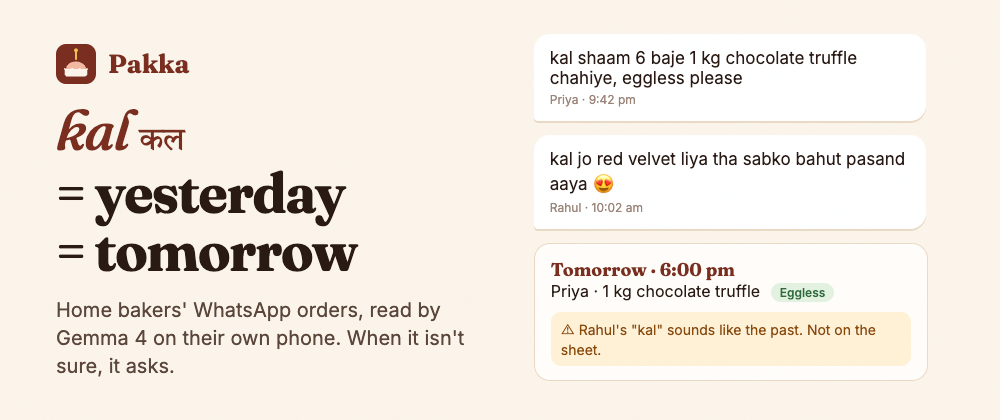
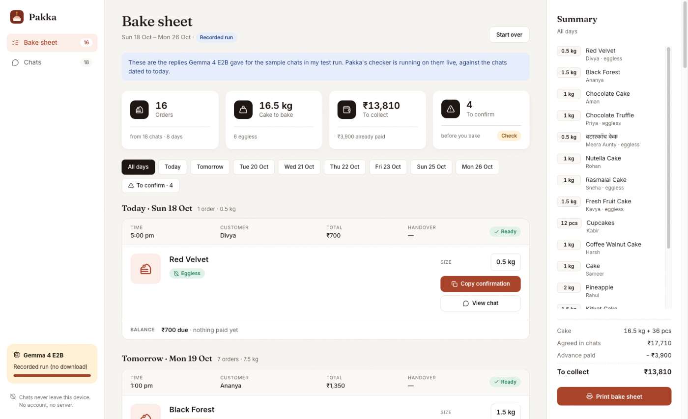
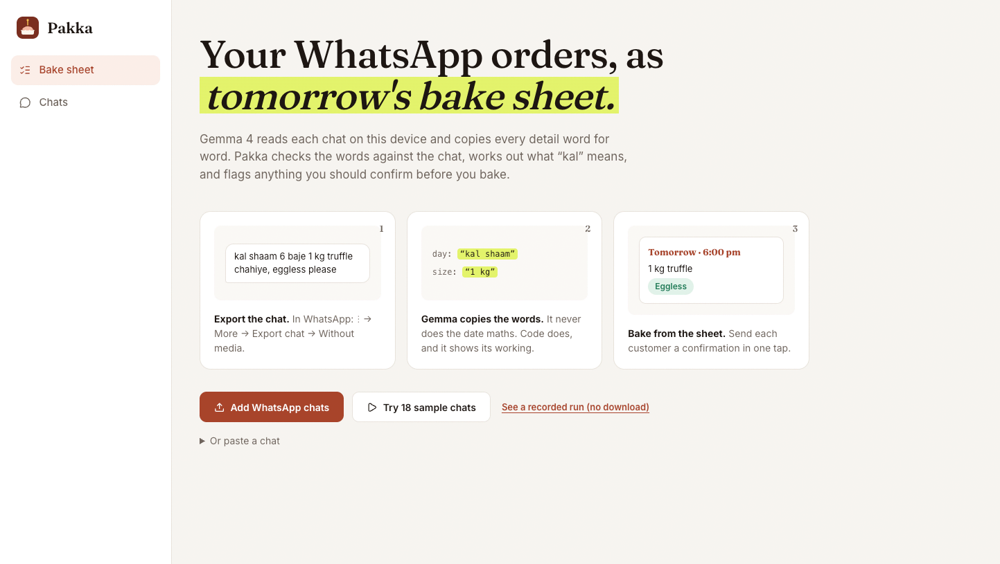
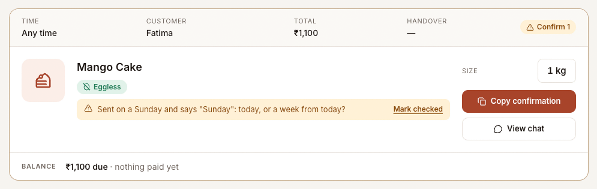
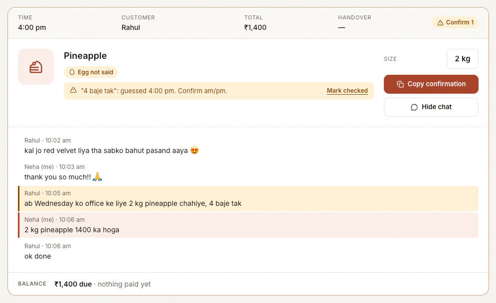
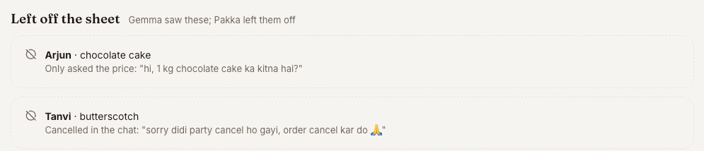
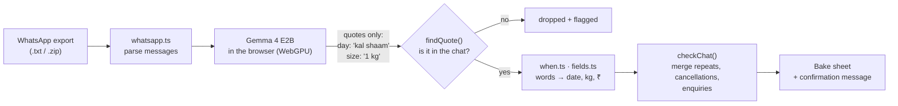

<a id="top"></a>

<p align="center">
  
</p>

<h1 align="center">Pakka</h1>

<p align="center">
  <b>A home baker's WhatsApp orders, turned into tomorrow's bake sheet.</b><br />
  Gemma 4 reads the chats on the baker's own device. Code checks every detail against the chat.
</p>

<p align="center">
  <a href="https://pakka-gamma.vercel.app"></a>
  
  
  
  
  <a href="LICENSE"></a>
</p>

<p align="center">
  <a href="https://pakka-gamma.vercel.app"><b>Try it</b></a> ·
  <a href="https://pakka-gamma.vercel.app/?replay"><b>Recorded run (no download)</b></a> ·
  <a href="https://dev.to/codeswithroh/kal-means-yesterday-and-tomorrow-i-built-home-bakers-a-whatsapp-order-sheet-that-never-guesses-21p3"><b>Write-up</b></a> ·
  <a href="#eval"><b>Eval</b></a>
</p>

<p align="center">
  
</p>

---

## Contents

- [Why](#why)
- [What it does](#what-it-does)
- [How it works](#how-it-works)
- [Eval](#eval)
- [Quick start](#quick-start)
- [Project layout](#project-layout)
- [Limitations and roadmap](#limitations-and-roadmap)
- [FAQ](#faq)
- [Credits and licence](#credits-and-licence)

## Why

In Hindi, **kal** means tomorrow. It also means yesterday.

> *"Kal shaam 6 baje 1 kg truffle chahiye"* is an order for tomorrow evening.
> *"Kal jo cake liya tha, sabko pasand aaya"* is a thank-you for a cake that's already been eaten.

Home bakers in India run real businesses from WhatsApp. The order book is the chat list, and the night before a busy
day means scrolling every chat and copying cakes into a notebook. A small model asked for the finished answer gets
those dates wrong with total confidence. In our eval, Gemma alone put **5 of its 12 wrong dates on "tomorrow"**.

Pakka's rule: **when it isn't sure, it asks the baker. It doesn't guess.**

<p align="right"><a href="#top">back to top ↑</a></p>

## What it does

| | |
|---|---|
|  | **Add chats, nothing else.** Export a chat from WhatsApp (⋮ → More → Export chat → Without media) and drop in the `.txt`, or the `.zip` an iPhone makes. No account, no upload. |
|  | **Flags instead of guesses.** "Sunday" sent on a Sunday, "next Sunday", a time with no am/pm, a size changed later in the chat: each gets an amber note saying exactly why. |
|  | **Shows its working.** Every card can open the chat it came from, with the lines each detail was copied from highlighted. |
|  | **Knows what isn't an order.** Price questions and cancelled orders are listed separately, never on the sheet. |

Plus: a summary panel with totals to bake and collect, day filters, a printable sheet, a light/dark toggle (follows the system until you pick), and a **Copy confirmation**
button that writes a WhatsApp message for the customer to check.

<p align="right"><a href="#top">back to top ↑</a></p>

## How it works

Gemma does the part small models are good at: find the order and **copy the exact words**. Code does everything that
turns words into a date, a weight or a rupee amount.



<details>
<summary><b>How "kal" gets resolved</b></summary>

`when.ts` reads the day relative to **when that message was sent**, not when the app is opened. For the two-way words
(*kal*, *parso*) it looks at the clause the word sits in: past-tense markers (*tha, liya, diya, bheja, aaya*) against
request markers (*chahiye, dena, ready, pickup, tak*). Clauses split on punctuation and *aur / par / lekin*, because
real messages mix tenses: *"kal 4 baje de dena, 500 bhej diya"* is still an order for tomorrow.

It also handles weekdays (English and Hindi), "25th", "25 tarikh", month rollover, Devanagari (*कल शाम 7 बजे*), and
times with no am/pm, which it guesses and labels as guessed.
</details>

<details>
<summary><b>What the model actually returns</b></summary>

```json
{"item": "chocolate truffle", "size": "1 kg", "eggless": "eggless please",
 "day": "kal shaam", "time": "6 baje", "cake_message": "upar likh dena \"Happy Birthday Riya\"",
 "price": "1200 hoga", "advance": "500 advance bhej diya"}
```

Every value is a quote. A quote that isn't in the chat is dropped and the card says so.
</details>

<p align="right"><a href="#top">back to top ↑</a></p>

<a id="eval"></a>

## Eval

Gemma 4 E2B, same runtime as the app (MediaPipe on WebGPU, Chromium on a Mac mini M4). Each chat was run two ways:
**Gemma alone** (told today's date, asked for finished values) and **Pakka** (Gemma copies the words, code reads them).

| | Main set · 18 chats, 16 orders | | Held-out · 8 chats, 7 orders | |
|---|:---:|:---:|:---:|:---:|
| | Gemma alone | **Pakka** | Gemma alone | **Pakka** |
| Delivery day right | 4 | **16** | 3 | **6** (1 asked) |
| Delivery day **confidently wrong** | 8 | **0** | 4 | **0** |
| Size right | 13 | **16** | 6 | **7** |
| Price right | 13 | **16** | 7 | **7** |
| Orders that weren't orders | 3 | **0** | 0 | **0** |

<details>
<summary><b>Method, and what was tuned</b></summary>

- The chats are hand-written and made up, modelled on how WhatsApp orders read. They include traps: *kal* about
  yesterday, *parso* about a complaint, a size changed the next morning, a cancellation, price questions only,
  Devanagari, two orders in one chat, "next Sunday", and a weekday named on the same weekday. See
  [`src/core/samples.ts`](src/core/samples.ts) and [`src/core/heldout.ts`](src/core/heldout.ts).
- The main-set Pakka numbers include three chat-level rules and one bug fix made after its first run (15 right, 1
  asked, 0 wrong, 3 non-orders), so they are tuned on that set.
- The held-out set was written after the code was frozen and run once. It found one bug ("the day after tomorrow"
  read as two days, so Pakka asked), fixed afterwards in `when.ts` with a test.
- Speed: median 2.4 s per chat once the model is loaded.
</details>

Reproduce the scores from the committed raw replies, no model needed:

```bash
node eval/rescore.ts eval/results/main.json -v
node eval/score-heldout.ts -v
```

<p align="right"><a href="#top">back to top ↑</a></p>

## Quick start

Requires Node 22.6+ (the eval scripts use built-in TypeScript type stripping).

```bash
git clone https://github.com/codeswithroh/pakka.git
cd pakka
npm install
npm run dev
```

Open the printed URL in Chrome or Edge (or Safari 26). The first real run downloads Gemma once, about 2 GB.

| Command | What it does |
|---|---|
| `npm run dev` | App with hot reload |
| `npm test` | Parser, date and checker tests (no model) |
| `npm run build && npx vite preview` | Production build; open `/eval.html` to run the eval in the browser |

<p align="right"><a href="#top">back to top ↑</a></p>

## Project layout

```
src/
  core/
    whatsapp.ts   export parser (Android + iPhone formats, multi-line messages)
    when.ts       day/time resolution, kal/parso tense check
    fields.ts     size, money and eggless parsers; quote grounding; change detection
    extract.ts    the prompt, reply parsing, checkOrder(), checkChat(), confirmation text
    samples.ts    18 test chats with expected bake-sheet values (also the demo)
    heldout.ts    8 held-out chats
  llm.ts          Gemma 4 E2B via MediaPipe on WebGPU, cached in the Cache API
  main.ts         the app: sidebar shell, stats, order cards, summary panel, chats table
  icons.ts        Lucide icons
eval/             eval page, benchmark, rescorers, recorded results
test/             node:test suites
```

<p align="right"><a href="#top">back to top ↑</a></p>

## Limitations and roadmap

- [x] On-device Gemma 4 E2B, no server
- [x] Quote grounding, date resolution, change detection
- [x] Enquiries and cancellations kept off the sheet
- [x] Held-out eval with committed raw replies
- [ ] Voice notes (Gemma 4 E2B takes audio; not built yet)
- [ ] Android share target, so an export lands in Pakka without saving a file
- [ ] Menu and price list, to check agreed prices
- [ ] Tested with real bakers' chats (the eval set is hand-written)

Needs WebGPU and room for a 2 GB model. Browsers that cap per-site storage will download it again on each visit.

<p align="right"><a href="#top">back to top ↑</a></p>

## FAQ

<details>
<summary><b>Do my chats get uploaded anywhere?</b></summary>

No. Parsing, the model and the checks all run in the browser. The only network request is the one-time model download
from Hugging Face.
</details>

<details>
<summary><b>Why not just ask the model for the date?</b></summary>

That's the "Gemma alone" column in the eval: 12 confidently wrong delivery days across both sets. Copying words is
something a 2B-effective model does well; date arithmetic in a language where one word means two days is not.
</details>

<details>
<summary><b>My phone can't run it. Can I still see it work?</b></summary>

Yes: [pakka-gamma.vercel.app/?replay](https://pakka-gamma.vercel.app/?replay) replays Gemma's recorded replies for the
sample chats through the live checker. It can't read your own chats without the model.
</details>

<p align="right"><a href="#top">back to top ↑</a></p>

## Credits and licence

- [Gemma 4](https://ai.google.dev/gemma) by Google DeepMind (Apache 2.0), web build from
  [litert-community](https://huggingface.co/litert-community/gemma-4-E2B-it-litert-lm)
- [MediaPipe LLM Inference](https://ai.google.dev/edge/mediapipe/solutions/genai/llm_inference)
- [Lucide](https://lucide.dev) icons, [Fraunces](https://fonts.google.com/specimen/Fraunces) and
  [Inter](https://rsms.me/inter/) fonts, [fflate](https://github.com/101arrowz/fflate) for `.zip` exports

Built for the DEV Hacktoberfest Open-Source AI Challenge (Week 2: Side Hustle). Released under the [MIT licence](LICENSE).

<p align="right"><a href="#top">back to top ↑</a></p>
